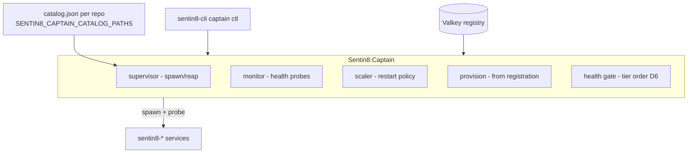

# Sentin8:Captain - Process Supervisor & Orchestration Layer

> A **starter** - builds and boots before any service (RS §2.5). Captain
> links no service binary (invariant RS-2): it spawns, monitors, and
> health-gates processes, reading their self-description from
> `--print-registration` output and `catalog.json` files.
>
> Docs: `README.md` (overview) · `DESIGN.md` (detailed design, §11 = the
> fleet plane) · `BUSINESS.md` (business requirements).

## 1. Summary

Sentin8:Captain is the platform's process supervisor. It spawns the
service fleet from the captain catalog (tier order, health-gated -
`SENTIN8_CAPTAIN_CATALOG_PATHS` composes per-repo `catalog.json`
files), monitors liveness via `/v1/health` probes, and exposes
instance lifecycle (start/stop/upgrade with zero-downtime drain) plus
fleet status.

## 2. Motivation

- **Boot is a readiness contract, not a timing heuristic.** Tiers wait
  for the previous tier to report `Active` (bounded wait, warn-degrade
  on timeout) instead of sleeping between starts.
- **One control plane for the fleet.** Restart, rolling upgrade, and
  status go through one supervised authority - no stray processes, no
  stale registry entries.

## 3. Architecture & High-Level Design



## 4. Key Concepts

- **Tier order** - captain → acme → auth,proxy → bus → data plane →
  sys,app → bff,web; each tier gates on the previous tier's `Active`.
- **Instance registry** - `Active` entries live in Valkey; the
  round-robin and status views read it.
- **Upgrades** - start new → wait `Active` → drain old (10s) → stop:
  zero-downtime swaps.
- **Placement (DESIGN §11.3)** - every spawn site consults one gate:
  `pin:{ip}` (the operator's edge pseudo-IP resolves via
  `SENTIN8_CAPTAIN_EDGE_IP`), `anti:{service}` (per-machine
  co-location), and the fleet `singleton` flag (acme - the CA; proxy -
  the :443 ingress). A violation is a structured refusal, never a
  wrong-machine spawn.
- **Crash-loop give-up + slow self-recovery (DESIGN §5.10.1)** - after
  the restart cap the service is alerted (WARN-10) AND re-attempted one
  spawn per `SENTIN8_CAPTAIN_LAST_RESORT_RESPAWN_S` (default 300s, `0`
  disables) until it comes back; the alert clears only when the service
  is `Active` again.
- **TLS warm-up grace (DESIGN §5.10.2)** - a live process waiting for
  its on-demand server cert (`AccessDenied` / connect-refusal during
  warm-up) is not probe-killed for `SENTIN8_CAPTAIN_CERT_GRACE_S`
  (default 120s); a non-2xx HTTP answer is never masked. Cold starts
  and upgrades no longer mass-kill freshly spawned services while acme
  is saturated.
- **Fleet plane (DESIGN §11)** - machine provisioning via OpenTofu
  (`tofu/` module kit: docker dev backend, AWS cloud, Proxmox
  hypervisor), fleet-published enrollment records so any machine's
  acme verifies any machine's first-boot claim, and remote spawn
  (`POST /v1/captain/instances`) driven by the autoscaler leader's
  `captain-remote` M2M workload or an operator's `captain place`.

## 5. Usage

```bash
sentin8-cli captain start          # spawn the fleet, health-gated
sentin8-cli captain status         # fleet table (KEY, version, state)
sentin8-cli captain upgrade-instance KEY=<ip:port>   # rolling swap
sentin8-cli captain autoscaler     # profile, backend, machines, pending
sentin8-cli captain place --ip=10.0.0.7 sentin8:stat   # hand-place a service
make fleet-up                      # multi-machine dev entry (docker backend)
```

See `DESIGN.md` for the supervisor/monitor/scaler internals and the
D6 health-gate design; `BUSINESS.md` for the operational capability
list.

---

**Design attribution:** sentin8:captain and its underlying concepts were designed by Hamid Jahanzad <Hamid@Jahanzad.com>.
